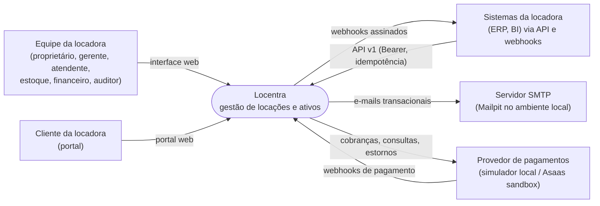
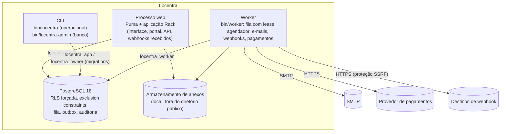

# Arquitetura do Locentra

Monólito modular com arquitetura hexagonal pragmática, escrito em Ruby 4.0.9 sem framework de aplicação
e sem ORM. Estado de implementação em [`STATUS.md`](STATUS.md); decisões em [`DECISOES.md`](DECISOES.md).

## C4 — Contexto

## C4 — Contêineres

## Camadas

| Camada | Diretório | Responsabilidade | Depende de |
|---|---|---|---|
| Domínio | `lib/locentra/domain` | Entidades, value objects (`Money`, `Period`, `TimeZone`), máquinas de estado, regras puras | stdlib, tzinfo |
| Aplicação | `lib/locentra/application` | Casos de uso: autorização, coordenação do domínio, transações, portas | Domínio |
| Infraestrutura | `lib/locentra/infrastructure` | PostgreSQL, pool, repositórios SQL, fila, SMTP, PDF, armazenamento, provedores, HTTP seguro | Domínio, Aplicação |
| Interfaces | `lib/locentra/interfaces/{http,cli,worker}` | Rack/Puma, interface web, portal, API, CLI, worker | Aplicação |
| Composição | `lib/locentra/system.rb`, `lib/locentra/wiring/` | Composition root explícito (montagens por módulo em `wiring/`: `commercial_terms.rb` e `organizations.rb`); nenhuma conexão aberta na montagem | Todas |

Carregar `locentra/domain` e `locentra/application` não abre conexões, não inicia threads, não lê variáveis
de ambiente e não carrega infraestrutura. A aplicação declara as exceções das portas que os adaptadores
levantam (`Integrations::UnsafeDestination`, `Attachments::InvalidStorageKey`, `Attachments::ContentMissing`)
e recebe por injeção o que é de infraestrutura (o assinador de webhooks, por exemplo).
`LayerIsolationTest` verifica isso em processo separado e executa a entrega de webhook e o download de
anexo só com portas falsas. A suíte unitária não usa banco, rede nem servidor, mas também exercita alguns
adaptadores de infraestrutura (cifragem, armazenamento, HTTP seguro, Asaas) no mesmo processo.

## Contextos

| Contexto | Domínio | Casos de uso | Documentação |
|---|---|---|---|
| Organizações e identidade | `identity.rb`, `organizations.rb` | `identity.rb`, `organizations.rb`, `integrations.rb` | [Permissões](PERMISSOES.md), [Isolamento](ISOLAMENTO.md) |
| Configurações da organização e filiais | `organizations.rb` (`Organization`, `Branch`), `organization_settings.rb` (`Settings`, `CancellationPolicy`) | `organization_settings.rb` (`BranchGuard`, configurações e filiais), montados por `wiring/organizations.rb` | [Módulo](modulos/configuracoes-organizacao.md) |
| Clientes | `customers.rb` | `customers.rb` | — |
| Catálogo e ativos | `catalog.rb` | `catalog.rb` | [Máquinas de estado](MAQUINAS-DE-ESTADO.md) |
| Disponibilidade e reservas | `availability.rb`, `reservations.rb` | `availability.rb`, `reservations.rb` | [Motor de disponibilidade](DISPONIBILIDADE.md) |
| Precificação | `pricing.rb` | `reservations.rb` (`Pricer`) | [Precificação](PRECIFICACAO.md) |
| Condições comerciais | `commercial_terms.rb`, `pricing.rb` (`Coupon`) | `commercial_terms.rb` | [Módulo](modulos/condicoes-comerciais.md), [Precificação](PRECIFICACAO.md) |
| Orçamentos e contratos | `quotes.rb`, `contracts.rb` | `quotes.rb`, `contracts.rb` | [Módulo](modulos/orcamentos-contratos.md) |
| Retirada, devolução, manutenção | `fulfillment.rb`, `maintenance.rb`, `transfers.rb`, `alerts.rb` | `fulfillment.rb`, `returns.rb`, `inspections.rb`, `maintenance.rb`, `transfers.rb`, `overdue.rb` | [Módulo](modulos/retirada-devolucao-manutencao.md) |
| Financeiro e cauções | `finance/*` | `finance/*` | [Módulo](modulos/financeiro.md), [Caução](CAUCAO.md) |
| Portal do cliente | `portal.rb` | `portal.rb` | [Módulo](modulos/portal-cliente.md) |
| Notificações e integrações | `webhooks.rb` (`Circuit`) | `notifications.rb`, `webhooks.rb`, `retention.rb`, `attachments.rb`, `external_calls.rb` | ADR-020 a ADR-022, ADR-029, [Módulo](modulos/worker-webhooks-retencao.md) |
| CLI operacional | — | `integrations.rb`, `jobs.rb` | [Módulo](modulos/cli-operacional.md) |
| Observabilidade e navegador | — | métricas e correlação | [Módulo](modulos/navegador-observabilidade.md) |
| Auditoria | — | `AuditTrail` em `base.rb` | — |
| Assinaturas da plataforma | — | `PlanLimits` em `organizations.rb` | ADR-012 |

## Persistência e transações

- `ConnectionPool`: pool por processo (gem `connection_pool`), conexões sob demanda, descarte das herdadas
  após fork, `ROLLBACK` defensivo e descarte de conexões quebradas na devolução; `statement_timeout` e
  `idle_in_transaction_session_timeout`.
- `Transactor`: abre a transação, define `app.tenant_id`/`app.user_id` com escopo local, repete em deadlock
  ou falha de serialização e proíbe transações aninhadas na mesma thread (composição por `tx:`; rollback
  parcial por `savepoint`).
- Repositórios recebem a transação como primeiro argumento e nunca acessam o pool; SQL parametrizado,
  ordenação e filtros por allowlist, mapeamento explícito para entidades.
- Migrations SQL versionadas com checksum e `pg_advisory_lock`, executadas com credencial própria.

Modelo de dados em [`MODELO-DE-DADOS.md`](MODELO-DE-DADOS.md).

## Processamento assíncrono

Fila no PostgreSQL (`jobs`) com prioridade, agendamento, tentativas, backoff, lease com token de fencing,
recuperação de leases vencidos e histórico (`job_attempts`). Eventos de negócio são gravados na outbox na
mesma transação da alteração, com a tarefa de despacho enfileirada atomicamente. O despacho fan-out gera
entregas de webhook (únicas por endpoint e evento), e-mails e tarefas de assinantes (financeiro). Chamadas de
rede nunca ocorrem com transação aberta.

## Execução e concorrência

- **Web:** Puma com `PUMA_THREADS` threads por processo e `WEB_CONCURRENCY` processos; sem `preload_app`,
  de modo que cada processo monta o próprio `System` depois do fork. `DB_POOL_SIZE` ≥ `PUMA_THREADS`.
- **Worker:** `WORKER_CONCURRENCY` threads de execução da fila `default` + `WEBHOOK_CONCURRENCY` threads
  (padrão 4) da fila `webhooks` + thread de heartbeat + thread de agendamento; pool com
  `WORKER_CONCURRENCY + WEBHOOK_CONCURRENCY + 2` conexões (10 com os padrões); encerramento gracioso em
  TERM/INT. As entregas de webhook vão para fila própria: um destino lento ocupa somente as threads dessa
  fila, nunca as de e-mails, pagamentos e varreduras. Nessa fila, cada organização tem no máximo
  `WEBHOOK_MAX_PER_ORGANIZATION` (padrão 2) execuções simultâneas somadas entre todos os workers, aplicado na
  reivindicação com lock consultivo por organização; endpoints com falhas consecutivas são pausados e as
  entregas ficam retidas até a reativação pela tela. A retenção do histórico de integrações roda por
  organização, no contexto do tenant, nas threads da fila `default`
  ([`modulos/worker-webhooks-retencao.md`](modulos/worker-webhooks-retencao.md)). Cada entrega tem prazo total
  de 15 s e lê no máximo 4 KiB da resposta.
  Banco indisponível faz os laços esperarem com backoff exponencial limitado a 30 s. Sinal de vida próprio:
  a thread de heartbeat atualiza `WORKER_HEALTH_FILE`, conferido por `bin/worker --check` (healthcheck do
  serviço no Compose).
- Toda exclusão entre processos é feita no banco (locks de linha, exclusion constraints, advisory locks,
  `SKIP LOCKED`, chaves únicas); mutex local é usado apenas para estruturas em memória do processo.
- Limites: não há medições de desempenho publicadas; o dimensionamento acima é a regra de configuração,
  não uma promessa de vazão.

## Camada HTTP

`RequestLogger` (request id, log estruturado, métricas por rota modelo) → `Rack::Static` → `BodyLimit` →
`SecurityHeaders` (CSP sem `unsafe-inline`, HSTS em produção) → roteador com tabela explícita →
autenticação por modo (`public`, `login`, `session`, `portal`, `api`, `staff_or_portal`) → CSRF →
controlador → erros centralizados (HTML ou JSON estruturado com `request_id`). Templates ERB compilados uma
vez, com escape automático; JavaScript em módulos ES sem scripts inline. API v1 documentada em
[`openapi.yaml`](openapi.yaml), com idempotência por chave, escopo e fingerprint.

## Observabilidade

Logs JSON por linha com redação de campos sensíveis e correlação por `request_id` (requisição → outbox →
tarefa → operação externa). Métricas Prometheus em `/metrics` (protegido por `METRICS_TOKEN` quando
definido; em produção, sem token, o endpoint fica desativado) com rótulos de baixa cardinalidade. `/health/live` e `/health/ready` (banco e migrations).
