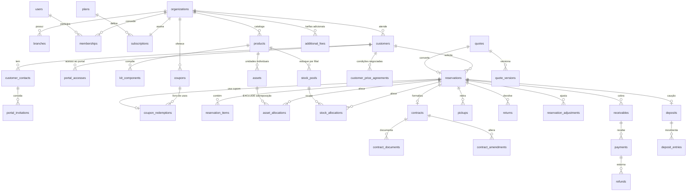

# Modelo de dados

PostgreSQL 18, schema `public`, migrations em `db/migrations` (SQL versionado com checksum). Convenções:

- Identificadores UUIDv7 gerados pela aplicação; instantes `timestamptz` em UTC; valores monetários em
  centavos (`bigint`); períodos `tstzrange` semiabertos `[início, fim)`.
- Tabelas de tenant têm `organization_id NOT NULL`, `UNIQUE (organization_id, id)`, chaves estrangeiras
  compostas `(organization_id, <ref>_id)` e RLS habilitada e forçada (`app_enable_tenant_rls`).
- Históricos e registros financeiros confirmados são somente inserção (UPDATE/DELETE revogados) ou
  protegidos por gatilhos; correções são operações compensatórias.

## Relações principais

## Garantias no banco

| Invariante | Mecanismo |
|---|---|
| Ativo não alocado duas vezes no mesmo período | `asset_allocations_no_overlap EXCLUDE USING gist (asset_id WITH =, period WITH &&) WHERE (active)` |
| Kit contém apenas produtos físicos | FK composta `(organization_id, component_id, component_tracking)` com `CHECK` |
| Ativo pertence a produto individual; estoque a produto quantitativo | FK composta com coluna de rastreamento fixa |
| Sem relações entre organizações | FKs compostas `(organization_id, id)` |
| Conversão de orçamento única | índice único parcial `reservations (organization_id, quote_id)` |
| Retirada/devolução não duplicadas | índices únicos parciais por alocação; somas limitadas por `CHECK`/lock |
| Reembolso ≤ valor confirmado | lock do pagamento + verificação no banco |
| Webhook recebido uma vez | `UNIQUE (organization_id, provider, event_id)` |
| Entrega de webhook única por evento | `UNIQUE (endpoint_id, event_id)` |
| Agendamento único por janela | índice único `jobs (unique_key)` |
| Idempotência de API | `UNIQUE (organization_id, scope, key)` |
| Código de cupom e de tarifa único por organização | `UNIQUE (organization_id, code)` em `coupons` e `additional_fees`, com `CHECK` do formato |
| Código, tipo e valor do cupom e código da tarifa não mudam | `UPDATE` concedido a `locentra_app` somente nas colunas editáveis e, em `coupons`, também no contador legado `redemptions` (mantido apenas para o retorno à 1.0.0; a 1.1.0 não grava a coluna, e o congelamento é regra da aplicação); `DELETE` de tarifa revogado |
| No máximo um uso de cupom por reserva; uso imutável | `UNIQUE (organization_id, reservation_id)` em `coupon_redemptions`; `UPDATE` e `DELETE` revogados |
| Usos ativos do cupom ≤ `max_redemptions` | Gatilho `coupon_redemptions_enforce_limit` (`BEFORE INSERT`): trava o cupom e conta os usos ativos no instante do uso (bloqueio vencido conta durante a carência de 5 minutos); a aplicação faz a mesma verificação sob `FOR UPDATE` |
| Vigência do cupom com fim posterior ao início e máximo de usos até 1.000.000 | Gatilho `coupons_enforce_limits` (`BEFORE INSERT OR UPDATE`): verifica a inserção e as colunas alteradas, para que cupons da 1.0.0 fora desses limites continuem desativáveis e reativáveis |
| Cupom com uso registrado não é excluído | FK composta de `coupon_redemptions` para `coupons`, sem cascata |
| Condições negociadas do mesmo cliente e escopo sem vigências sobrepostas | `customer_price_agreements_no_overlap EXCLUDE USING gist` sobre `price_agreement_window(valid_from, valid_until, ended_at)` |
| Condição negociada imutável, com encerramento único | `UPDATE` concedido somente em `ended_at`, `ended_by` e `end_reason`; gatilho `customer_price_agreements_end_once`; `CHECK` de coerência entre instante, motivo e autor; `DELETE` revogado |
| Snapshot de preços da reserva e dos itens imutável | Gatilhos `reservations_pricing_immutable` e `reservation_items_pricing_immutable` (`BEFORE UPDATE OF pricing`) |

## Dicionário de tabelas

Gerado a partir do banco migrado (`information_schema`). `!` indica `NOT NULL`. Coluna RLS: habilitada/forçada.

### Plataforma e identidade (global)

| Tabela | RLS | Colunas |
|---|---|---|
| `plans` | não | id:text!, name:text!, monthly_price_cents:bigint!, implementation_fee_cents:bigint!, max_assets:integer, max_branches:integer, max_users:integer, features:array!, position:integer!, active:boolean! |
| `users` | não | id:uuid!, email:text!, name:text!, password_digest:text!, email_confirmed_at:timestamptz, failed_login_count:integer!, locked_until:timestamptz, created_at:timestamptz!, updated_at:timestamptz! |
| `sessions` | não | id:uuid!, token_digest:text!, kind:text!, user_id:uuid!, organization_id:uuid, csrf_token:text!, ip:text, user_agent:text, created_at:timestamptz!, last_seen_at:timestamptz!, idle_expires_at:timestamptz!, absolute_expires_at:timestamptz!, revoked_at:timestamptz, revoked_reason:text |
| `user_tokens` | não | id:uuid!, user_id:uuid!, purpose:text!, token_digest:text!, expires_at:timestamptz!, used_at:timestamptz, created_at:timestamptz! |
| `rate_limits` | não | bucket:text!, window_start:timestamptz!, hits:integer! |
| `organizations` | sim/sim | id:uuid!, name:text!, slug:text!, legal_document:text, timezone:text!, status:text!, settings:jsonb!, created_at:timestamptz!, updated_at:timestamptz! |
| `queue_stats` | não | queue:text!, status:text!, size:integer!, oldest_age_seconds:numeric!, updated_at:timestamptz! |
| `job_outcome_totals` | não | queue:text!, kind:text!, outcome:text!, total:bigint!, updated_at:timestamptz! |
| `schema_migrations` | não | version:text!, name:text!, checksum:text!, applied_at:timestamptz! |

### Organização, acesso e assinatura

| Tabela | RLS | Colunas |
|---|---|---|
| `branches` | sim/sim | id:uuid!, organization_id:uuid!, name:text!, code:text!, address:text, active:boolean!, created_at:timestamptz!, updated_at:timestamptz! |
| `memberships` | sim/sim | id:uuid!, organization_id:uuid!, user_id:uuid!, role:text!, status:text!, created_at:timestamptz!, updated_at:timestamptz!, revoked_at:timestamptz, revoked_by:uuid |
| `invitations` | sim/sim | id:uuid!, organization_id:uuid!, email:text!, role:text!, token_digest:text!, invited_by:uuid!, expires_at:timestamptz!, accepted_at:timestamptz, accepted_user_id:uuid, revoked_at:timestamptz, created_at:timestamptz! |
| `subscriptions` | sim/sim | id:uuid!, organization_id:uuid!, plan_id:text!, status:text!, started_at:timestamptz!, trial_ends_at:timestamptz, current_period_start:date!, current_period_end:date!, implementation_fee_cents:bigint!, extra_features:array!, cancelled_at:timestamptz, created_at:timestamptz!, updated_at:timestamptz! |
| `organization_counters` | sim/sim | organization_id:uuid!, name:text!, value:bigint! |
| `api_credentials` | sim/sim | id:uuid!, organization_id:uuid!, name:text!, kind:text!, token_digest:text!, token_hint:text!, scopes:array!, created_by:uuid, created_at:timestamptz!, expires_at:timestamptz, revoked_at:timestamptz, last_used_at:timestamptz |
| `portal_invitations` | sim/sim | id:uuid!, organization_id:uuid!, customer_id:uuid!, contact_id:uuid!, email:text!, token_digest:text!, invited_by:uuid!, expires_at:timestamptz!, accepted_at:timestamptz, accepted_user_id:uuid, revoked_at:timestamptz, revoked_by:uuid, created_at:timestamptz! |
| `portal_accesses` | sim/sim | id:uuid!, organization_id:uuid!, user_id:uuid!, customer_id:uuid!, status:text!, created_by:uuid, created_at:timestamptz!, revoked_at:timestamptz, contact_id:uuid, invitation_id:uuid, revoked_by:uuid, updated_at:timestamptz |
| `audit_events` | sim/sim | id:uuid!, organization_id:uuid!, actor_type:text!, actor_id:uuid, action:text!, resource_type:text!, resource_id:uuid, request_id:text, ip:text, details:jsonb!, occurred_at:timestamptz! |
| `idempotency_keys` | sim/sim | id:uuid!, organization_id:uuid!, scope:text!, key:text!, fingerprint:text!, response_status:integer!, response_body:jsonb!, created_at:timestamptz!, expires_at:timestamptz! |

### Clientes

| Tabela | RLS | Colunas |
|---|---|---|
| `customers` | sim/sim | id:uuid!, organization_id:uuid!, kind:text!, name:text!, trade_name:text, document:text!, email:text, phone:text, notes:text, status:text!, created_at:timestamptz!, updated_at:timestamptz! |
| `customer_contacts` | sim/sim | id:uuid!, organization_id:uuid!, customer_id:uuid!, name:text!, email:text, phone:text, role:text, document:text, authorized_pickup:boolean!, created_at:timestamptz! |
| `customer_addresses` | sim/sim | id:uuid!, organization_id:uuid!, customer_id:uuid!, label:text!, street:text!, number:text, complement:text, district:text, city:text!, state:text!, postal_code:text, created_at:timestamptz! |
| `customer_price_agreements` | sim/sim | id:uuid!, organization_id:uuid!, customer_id:uuid!, product_id:uuid, discount_bps:integer!, valid_until:timestamptz, notes:text, created_by:uuid, created_at:timestamptz!, valid_from:timestamptz!, ended_at:timestamptz, ended_by:uuid, end_reason:text |

### Catálogo e ativos

| Tabela | RLS | Colunas |
|---|---|---|
| `products` | sim/sim | id:uuid!, organization_id:uuid!, sku:text!, name:text!, description:text, category:text, tracking:text!, buffer_before_minutes:integer!, buffer_after_minutes:integer!, deposit_cents:bigint!, replacement_cost_cents:bigint!, pricing:jsonb!, active:boolean!, created_at:timestamptz!, updated_at:timestamptz! |
| `kit_components` | sim/sim | organization_id:uuid!, kit_id:uuid!, kit_tracking:text!, component_id:uuid!, component_tracking:text!, quantity:integer! |
| `assets` | sim/sim | id:uuid!, organization_id:uuid!, product_id:uuid!, product_tracking:text!, branch_id:uuid!, tag:text!, serial_number:text, condition:text!, status:text!, unavailable_until:timestamptz, acquisition_cost_cents:bigint!, acquired_on:date, notes:text, version:integer!, created_at:timestamptz!, updated_at:timestamptz! |
| `asset_events` | sim/sim | id:uuid!, organization_id:uuid!, asset_id:uuid!, kind:text!, from_status:text, to_status:text, from_branch_id:uuid, to_branch_id:uuid, actor_id:uuid, reference_type:text, reference_id:uuid, notes:text, occurred_at:timestamptz! |
| `stock_pools` | sim/sim | id:uuid!, organization_id:uuid!, product_id:uuid!, product_tracking:text!, branch_id:uuid!, total_quantity:integer!, created_at:timestamptz!, updated_at:timestamptz! |
| `stock_movements` | sim/sim | id:uuid!, organization_id:uuid!, stock_pool_id:uuid!, kind:text!, quantity_delta:integer!, reason:text, actor_id:uuid, reference_type:text, reference_id:uuid, occurred_at:timestamptz! |

### Reservas, disponibilidade e preços

| Tabela | RLS | Colunas |
|---|---|---|
| `reservations` | sim/sim | id:uuid!, organization_id:uuid!, branch_id:uuid!, customer_id:uuid!, code:text!, status:text!, source:text!, starts_at:timestamptz!, ends_at:timestamptz!, hold_expires_at:timestamptz, quote_id:uuid, notes:text, pricing:jsonb!, total_cents:bigint!, deposit_cents:bigint!, overdue_since:timestamptz, created_by:uuid, confirmed_at:timestamptz, cancelled_at:timestamptz, cancellation_reason:text, expired_at:timestamptz, version:integer!, created_at:timestamptz!, updated_at:timestamptz! |
| `reservation_items` | sim/sim | id:uuid!, organization_id:uuid!, reservation_id:uuid!, product_id:uuid!, quantity:integer!, position:integer!, pricing:jsonb!, total_cents:bigint!, created_at:timestamptz! |
| `asset_allocations` | sim/sim | id:uuid!, organization_id:uuid!, asset_id:uuid!, product_id:uuid!, reservation_id:uuid, reservation_item_id:uuid, kind:text!, reason:text, period:tstzrange!, active:boolean!, created_by:uuid, created_at:timestamptz!, released_at:timestamptz |
| `stock_allocations` | sim/sim | id:uuid!, organization_id:uuid!, stock_pool_id:uuid!, product_id:uuid!, reservation_id:uuid, reservation_item_id:uuid, kind:text!, reason:text, quantity:integer!, period:tstzrange!, active:boolean!, created_by:uuid, created_at:timestamptz!, released_at:timestamptz |
| `reservation_adjustments` | sim/sim | id:uuid!, organization_id:uuid!, reservation_id:uuid!, reservation_item_id:uuid, kind:text!, amount_cents:bigint!, details:jsonb!, created_by:uuid, created_at:timestamptz! |
| `coupons` | sim/sim | id:uuid!, organization_id:uuid!, code:text!, kind:text!, value:bigint!, valid_from:timestamptz, valid_until:timestamptz, max_redemptions:integer, redemptions:integer!, min_subtotal_cents:bigint!, active:boolean!, created_at:timestamptz!, description:text, created_by:uuid, updated_at:timestamptz!, deactivated_at:timestamptz, lock_version:integer! |
| `coupon_redemptions` | sim/sim | id:uuid!, organization_id:uuid!, coupon_id:uuid!, reservation_id:uuid!, subtotal_cents:bigint!, discount_cents:bigint!, redeemed_by:uuid, redeemed_at:timestamptz! |
| `additional_fees` | sim/sim | id:uuid!, organization_id:uuid!, code:text!, name:text!, description:text, default_amount_cents:bigint!, active:boolean!, lock_version:integer!, created_by:uuid, created_at:timestamptz!, updated_at:timestamptz!, deactivated_at:timestamptz |

Condições comerciais (migration 0015; regras em [`PRECIFICACAO.md`](PRECIFICACAO.md) e
[`modulos/condicoes-comerciais.md`](modulos/condicoes-comerciais.md)):

- `coupons.value` está em pontos-base (`kind = percent`) ou em centavos (`kind = fixed`).
  `coupons.redemptions` é o contador da versão 1.0.0, congelado: os usos posteriores são linhas de
  `coupon_redemptions`, e os usos ativos são o contador legado mais os usos do livro cuja reserva está
  solicitada, confirmada, em andamento ou concluída, ou em bloqueio temporário ainda válido. `lock_version`
  serve ao controle otimista das edições.
- `coupon_redemptions` não guarda situação: o uso é liberado pelo cancelamento ou pela expiração da reserva,
  sem gravação. `subtotal_cents` e `discount_cents` são os valores da reserva no instante do uso.
- `customer_price_agreements`: `product_id` nulo é a condição geral; a vigência efetiva é
  `[valid_from, menor entre valid_until e ended_at)`. `ended_at` no futuro é um encerramento agendado.
  `valid_from` foi preenchida com `created_at` nas linhas anteriores à migration 0015.
- `additional_fees`: catálogo de tarifas; `default_amount_cents` é o valor aplicado quando o documento não
  informa outro. As tarifas aplicadas ficam no snapshot de preços da reserva ou da versão do orçamento, não
  em tabela própria.

### Orçamentos e contratos

| Tabela | RLS | Colunas |
|---|---|---|
| `quotes` | sim/sim | id:uuid!, organization_id:uuid!, code:text!, customer_id:uuid!, branch_id:uuid!, status:text!, current_version:integer!, approved_version:integer, hold_policy:text!, hold_minutes:integer, hold_reservation_id:uuid, reservation_id:uuid, sent_at:timestamptz, approved_at:timestamptz, approved_by_type:text, approved_by_user_id:uuid, approved_by_name:text, approved_ip:text, rejected_at:timestamptz, rejection_reason:text, expired_at:timestamptz, converted_at:timestamptz, created_by:uuid, created_at:timestamptz!, updated_at:timestamptz!, lock_version:integer! |
| `quote_versions` | sim/sim | id:uuid!, organization_id:uuid!, quote_id:uuid!, version:integer!, branch_id:uuid!, starts_at:timestamptz!, ends_at:timestamptz!, valid_until:timestamptz!, items:jsonb!, pricing:jsonb!, terms:text, manual_discount_bps:integer!, deposit_cents:bigint!, total_cents:bigint!, created_by:uuid, created_at:timestamptz!, sent_at:timestamptz |
| `contracts` | sim/sim | id:uuid!, organization_id:uuid!, code:text!, reservation_id:uuid!, customer_id:uuid!, quote_id:uuid, status:text!, terms_snapshot:jsonb!, current_document_version:integer!, issued_by:uuid, issued_at:timestamptz!, activated_at:timestamptz, closed_at:timestamptz, cancelled_at:timestamptz, cancellation_reason:text, cancellation_fee_cents:bigint, updated_at:timestamptz!, lock_version:integer! |
| `contract_documents` | sim/sim | id:uuid!, organization_id:uuid!, contract_id:uuid!, version:integer!, reason:text!, attachment_id:uuid!, sha256:text!, data_snapshot:jsonb!, generated_by:uuid, generated_at:timestamptz!, accepted_at:timestamptz, accepted_by_name:text, accepted_by_document:text, accepted_ip:text, user_agent:text, accepted_via:text, accepted_by_user_id:uuid, acceptance_statement:text |
| `contract_amendments` | sim/sim | id:uuid!, organization_id:uuid!, contract_id:uuid!, number:integer!, kind:text!, description:text!, changes:jsonb!, amount_delta_cents:bigint!, document_version:integer!, created_by:uuid, created_at:timestamptz! |

### Operação

| Tabela | RLS | Colunas |
|---|---|---|
| `pickups` | sim/sim | id:uuid!, organization_id:uuid!, reservation_id:uuid!, branch_id:uuid!, status:text!, picker_kind:text, contact_id:uuid, picker_name:text, picker_document:text, notes:text, started_by:uuid, started_at:timestamptz!, delivered_by:uuid, delivered_at:timestamptz, cancelled_at:timestamptz, version:integer! |
| `pickup_lines` | sim/sim | id:uuid!, organization_id:uuid!, pickup_id:uuid!, reservation_id:uuid!, reservation_item_id:uuid!, product_id:uuid!, asset_allocation_id:uuid, stock_allocation_id:uuid, asset_id:uuid, stock_pool_id:uuid, expected_quantity:integer!, checked_quantity:integer!, delivered_quantity:integer!, returned_quantity:integer!, missing_quantity:integer!, status:text!, checked_by:uuid, checked_at:timestamptz, release_reason:text |
| `returns` | sim/sim | id:uuid!, organization_id:uuid!, reservation_id:uuid!, pickup_id:uuid!, branch_id:uuid!, returned_at:timestamptz!, received_by:uuid, late_fee_cents:bigint!, completes_reservation:boolean!, notes:text, created_at:timestamptz! |
| `return_lines` | sim/sim | id:uuid!, organization_id:uuid!, return_id:uuid!, pickup_line_id:uuid!, reservation_item_id:uuid!, product_id:uuid!, asset_id:uuid, stock_pool_id:uuid, outcome:text!, quantity:integer!, requires_inspection:boolean!, notes:text, created_at:timestamptz! |
| `inspections` | sim/sim | id:uuid!, organization_id:uuid!, product_id:uuid!, branch_id:uuid!, asset_id:uuid, stock_pool_id:uuid, quantity:integer!, block_allocation_id:uuid, reservation_id:uuid, return_line_id:uuid, source_maintenance_order_id:uuid, status:text!, reason:text!, decision_notes:text, maintenance_order_id:uuid, created_at:timestamptz!, decided_by:uuid, decided_at:timestamptz |
| `damage_reports` | sim/sim | id:uuid!, organization_id:uuid!, code:text!, reservation_id:uuid!, reservation_item_id:uuid!, return_line_id:uuid!, product_id:uuid!, asset_id:uuid, stock_pool_id:uuid, quantity:integer!, kind:text!, severity:text!, description:text!, estimated_cost_cents:bigint!, status:text!, charged_cents:bigint, adjustment_id:uuid, decision_notes:text, decided_by:uuid, decided_at:timestamptz, created_by:uuid, created_at:timestamptz!, updated_at:timestamptz!, version:integer! |
| `maintenance_orders` | sim/sim | id:uuid!, organization_id:uuid!, code:text!, product_id:uuid!, branch_id:uuid!, asset_id:uuid, stock_pool_id:uuid, quantity:integer!, block_allocation_id:uuid, inspection_id:uuid, previous_status:text, status:text!, description:text!, cost_cents:bigint, requires_inspection:boolean, resolution_notes:text, opened_by:uuid, opened_at:timestamptz!, started_at:timestamptz, completed_at:timestamptz, cancelled_at:timestamptz, cancellation_reason:text, closed_by:uuid, version:integer! |
| `transfers` | sim/sim | id:uuid!, organization_id:uuid!, code:text!, product_id:uuid!, asset_id:uuid, quantity:integer!, from_branch_id:uuid!, to_branch_id:uuid!, from_pool_id:uuid, to_pool_id:uuid, status:text!, notes:text, requested_by:uuid, requested_at:timestamptz!, dispatched_by:uuid, dispatched_at:timestamptz, received_by:uuid, received_at:timestamptz, cancelled_by:uuid, cancelled_at:timestamptz, cancellation_reason:text, version:integer! |
| `reservation_alerts` | sim/sim | id:uuid!, organization_id:uuid!, reservation_id:uuid!, kind:text!, related_reservation_id:uuid, asset_id:uuid, stock_pool_id:uuid, dedup_key:text!, status:text!, details:jsonb!, created_at:timestamptz!, resolved_at:timestamptz, resolved_by:uuid, resolution:text |

### Financeiro

| Tabela | RLS | Colunas |
|---|---|---|
| `receivables` | sim/sim | id:uuid!, organization_id:uuid!, reservation_id:uuid!, customer_id:uuid!, kind:text!, source_type:text!, source_id:uuid!, description:text!, amount_cents:bigint!, currency:text!, due_on:date!, created_by:uuid, created_at:timestamptz! |
| `receivable_cancellations` | sim/sim | id:uuid!, organization_id:uuid!, receivable_id:uuid!, amount_cents:bigint!, reason:text!, created_by:uuid, created_at:timestamptz! |
| `payments` | sim/sim | id:uuid!, organization_id:uuid!, purpose:text!, receivable_id:uuid, deposit_id:uuid, reservation_id:uuid!, customer_id:uuid!, method:text!, provider:text!, provider_account_id:uuid, status:text!, amount_cents:bigint!, currency:text!, external_reference:text!, provider_payment_id:text, invoice_url:text, due_on:date, simulator_scenario:text, requires_review:boolean!, review_reason:text, failure_reason:text, submission_attempts:integer!, submission_started_at:timestamptz, notes:text, paid_at:timestamptz, confirmed_at:timestamptz, created_by:uuid, created_at:timestamptz!, updated_at:timestamptz! |
| `refunds` | sim/sim | id:uuid!, organization_id:uuid!, payment_id:uuid!, amount_cents:bigint!, reason:text!, status:text!, provider_reference:text, failure_reason:text, created_by:uuid, created_at:timestamptz!, updated_at:timestamptz!, confirmed_at:timestamptz, failed_at:timestamptz, submission_attempts:integer!, submission_started_at:timestamptz |
| `deposits` | sim/sim | id:uuid!, organization_id:uuid!, reservation_id:uuid!, customer_id:uuid!, kind:text!, expected_cents:bigint!, notes:text, created_by:uuid, created_at:timestamptz! |
| `deposit_entries` | sim/sim | id:uuid!, organization_id:uuid!, deposit_id:uuid!, kind:text!, amount_cents:bigint!, payment_id:uuid, receivable_id:uuid, method:text, notes:text, created_by:uuid, created_at:timestamptz! |
| `financial_entries` | sim/sim | id:uuid!, organization_id:uuid!, transaction_id:uuid!, position:smallint!, account:text!, debit_cents:bigint!, credit_cents:bigint!, source_type:text!, source_id:uuid!, memo:text!, occurred_at:timestamptz! |
| `invoices` | sim/sim | id:uuid!, organization_id:uuid!, number:text!, reservation_id:uuid!, customer_id:uuid!, total_cents:bigint!, settled_cents:bigint!, outstanding_cents:bigint!, lines:jsonb!, notes:text, created_by:uuid, issued_at:timestamptz! |
| `finance_alerts` | sim/sim | id:uuid!, organization_id:uuid!, kind:text!, status:text!, reservation_id:uuid, payment_id:uuid, message:text!, dedupe_key:text!, resolution:text, resolution_notes:text, resolved_by:uuid, resolved_at:timestamptz, created_at:timestamptz! |
| `payment_provider_accounts` | sim/sim | id:uuid!, organization_id:uuid!, provider:text!, name:text!, environment:text!, api_key_ciphertext:text, api_key_hint:text, webhook_token_digest:text!, webhook_token_hint:text!, active:boolean!, created_by:uuid, created_at:timestamptz!, deactivated_at:timestamptz |
| `payment_simulator_charges` | sim/sim | id:text!, organization_id:uuid!, account_id:uuid!, external_reference:text!, customer_reference:text!, billing_type:text!, value_cents:bigint!, due_date:date!, status:text!, refunds:jsonb!, created_at:timestamptz!, updated_at:timestamptz! |
| `reconciliation_reports` | sim/sim | id:uuid!, organization_id:uuid!, account_id:uuid!, provider:text!, status:text!, window_start:timestamptz!, started_at:timestamptz!, finished_at:timestamptz, summary:jsonb!, error:text |
| `reconciliation_items` | sim/sim | id:uuid!, organization_id:uuid!, report_id:uuid!, kind:text!, payment_id:uuid, provider_payment_id:text, external_reference:text, local_status:text, remote_status:text, local_amount_cents:bigint, remote_amount_cents:bigint, action:text!, created_at:timestamptz! |

### Integrações, fila e arquivos

| Tabela | RLS | Colunas |
|---|---|---|
| `outbox_events` | sim/sim | id:uuid!, organization_id:uuid!, event_type:text!, aggregate_type:text!, aggregate_id:uuid!, payload:jsonb!, correlation_id:text, occurred_at:timestamptz!, dispatched_at:timestamptz |
| `jobs` | sim/sim | id:uuid!, organization_id:uuid, queue:text!, kind:text!, payload:jsonb!, priority:smallint!, run_at:timestamptz!, status:text!, attempts:integer!, max_attempts:integer!, lease_token:uuid, lease_expires_at:timestamptz, locked_by:text, last_error:text, unique_key:text, correlation_id:text, created_at:timestamptz!, updated_at:timestamptz!, finished_at:timestamptz |
| `job_attempts` | sim/sim | id:uuid!, job_id:uuid!, organization_id:uuid, attempt:integer!, worker:text!, started_at:timestamptz!, finished_at:timestamptz, outcome:text, error:text |
| `webhook_endpoints` | sim/sim | id:uuid!, organization_id:uuid!, url:text!, description:text, events:array!, secret_ciphertext:text!, active:boolean!, created_by:uuid, created_at:timestamptz!, disabled_at:timestamptz |
| `webhook_deliveries` | sim/sim | id:uuid!, organization_id:uuid!, endpoint_id:uuid!, event_id:uuid!, event_type:text!, status:text!, attempts:integer!, last_status_code:integer, last_error:text, created_at:timestamptz!, last_attempt_at:timestamptz, delivered_at:timestamptz |
| `inbound_webhooks` | sim/sim | id:uuid!, organization_id:uuid!, provider:text!, event_id:text!, event_type:text!, payload:jsonb!, status:text!, received_at:timestamptz!, processed_at:timestamptz, error:text, provider_account_id:uuid |
| `attachments` | sim/sim | id:uuid!, organization_id:uuid!, owner_type:text!, owner_id:uuid!, filename:text!, content_type:text!, byte_size:bigint!, sha256:text!, storage_key:text!, created_by:uuid, created_at:timestamptz!, retain_until:timestamptz, deleted_at:timestamptz |

Retenção: tarefas `succeeded`/`cancelled` e suas tentativas são removidas 14 dias após a conclusão pelo
housekeeping do worker (índice parcial `jobs_finished_idx`, migration 0014); tarefas `dead`, eventos da
outbox, entregas de webhook e webhooks recebidos são mantidos (ver `RUNBOOKS.md`, seção 9).
